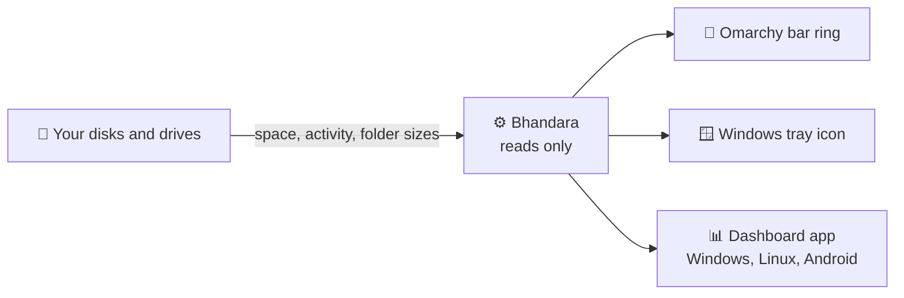

<h1 align="center">
  <br>
  <a href="https://github.com/sudharamachandranrajeev/bhandara"></a>
  <br>
  Bhandara
  <br>
</h1>

<h4 align="center">See how full your disks are, what is filling them, and when they are busy.</h4>

<p align="center">
  <a href="https://github.com/sudharamachandranrajeev/bhandara/releases"></a>
  
  <a href="LICENSE"></a>
  <a href="https://github.com/sudharamachandranrajeev/brahma"></a>
</p>

<p align="center">
  <a href="#-what-it-does">What it does</a> •
  <a href="#-get-started">Get started</a> •
  <a href="#-how-it-works">How it works</a> •
  <a href="#-faq-and-troubleshooting">FAQ</a> •
  <a href="#%EF%B8%8F-for-developers">For developers</a>
</p>

**Bhandara** (भण्डार, "storeroom") is a storage monitor. It shows every disk and drive on your
computer or phone, how much space is left, and which folders take the most. It comes as a ring in
the Omarchy bar, a Windows tray icon and a dashboard app. Status: **alpha (0.1)**. It reads your
disks and changes nothing, except a file or folder you choose to delete.

## ✨ What it does

- 💽 **Every drive at a glance** – each disk, partition and USB stick with its space used and free,
  plus its model, file system and whether it is encrypted.
- 🟠 **Colour warnings** – a drive's ring and bar turn amber at 80% full and red at 90%.
- 📈 **Disk activity** (Linux, Windows) – live read and write speed, with a short history.
- 📁 **Largest folders** – the five biggest folders in your home folder (on Android, in shared
  storage). On a computer, click one to open it.
- ⏏️ **Eject** (Linux, Windows) – safely eject a USB drive from the list.
- 🪟 **Windows tray icon** – a ring showing how full your system drive is. Click it for a quick
  view.
- 🧭 **Omarchy bar widget** – the same ring in your bar, with a panel of every drive.

Coming in the next release:

- 🩺 **Drive health** (*Swasthya*) – a plain Good / Watch / Replace verdict for each NVMe or SATA
  drive, with the reasons, life used and temperature, and a notification when a drive gets worse
  ([how it works](docs/drive-health.md)).
- 🗂️ **Files view** (*Suchi*) – browse everything on a drive inside the app, biggest first. See space
  by file type, the largest files (filter by size and age), and files that are exact copies of each
  other. Delete what you don't need: it goes to the Trash (on Android it is deleted for good, after
  a warning).

## 🚀 Get started

### Step 1 – Pick your version

| Your device | What to use | Works on |
| --- | --- | --- |
| 🐧 Omarchy | The **bar widget** (Step 2) | Omarchy |
| 🪟 Windows computer | `Bhandara_<version>_x64-setup.exe` or `Bhandara_<version>_x64_en-US.msi` from the [releases page](https://github.com/sudharamachandranrajeev/bhandara/releases) | Windows 10 and 11 (64-bit) |
| 🤖 Android phone | `Bhandara_<version>_android-debug.apk` from the [releases page](https://github.com/sudharamachandranrajeev/bhandara/releases) | 64-bit ARM phones (most phones from the last few years) |
| 🐧 Other Linux | The dashboard app, built from source (see [For developers](#%EF%B8%8F-for-developers)) | 64-bit Linux with WebKitGTK 4.1 |

Releases are marked *pre-release*, so look under the newest one, not "Latest".

### Step 2 – Install

<details>
<summary><b>🐧 Omarchy bar widget</b></summary>

1. Download the **Source code** zip from the newest release, or clone this repository.
2. Open a terminal in that folder and copy the widget into your Omarchy plugins:
   ```sh
   mkdir -p ~/.config/omarchy/plugins
   cp -r omarchy/bhandara.bar ~/.config/omarchy/plugins/
   ```
3. Turn it on: `omarchy plugin enable bhandara.bar`. Or add **Bhandara Storage** to your bar from
   Omarchy's bar settings.

</details>

<details>
<summary><b>🪟 Windows</b></summary>

1. Double-click `Bhandara_<version>_x64-setup.exe` (or the `.msi`).
2. Windows may say *"Windows protected your PC"*. This appears because the app isn't paid-signed
   yet, not because it is harmful. Click **More info → Run anyway**.
3. Follow the installer, then open **Bhandara** from the Start menu.

</details>

<details>
<summary><b>🤖 Android</b></summary>

1. Open the downloaded `.apk` on your phone. It is large (about 130 MB) because it is a test build.
2. If Android asks, allow installs from your browser or file manager. This is normal for apps
   from outside an app store.
3. Tap **Install**, then **Open**.

This is a debug build (a test build signed with a development key). A later signed release may
not install over it, so you might need to uninstall this one first.

</details>

### Step 3 – First look

- **Omarchy**: the ring sits in your bar and shows how full `/` is.
  - **Left-click** opens the panel with every drive, disk activity and the largest folders.
  - **Right-click** switches the label between percentage used, space free, and no label.
  - **Middle-click** opens the drive in your file manager.
  - Click **⏏** next to a USB drive to eject it.
- **Windows**: a ring appears in the tray. Click it for the quick view, then **Open dashboard** for
  the full window. Closing the dashboard keeps Bhandara in the tray. Right-click the tray icon and
  choose **Quit** to stop it.
- **Android**: the app lists your storage. To see the largest folders, tap **Allow access** and
  turn on **All files access** for Bhandara. Android asks because the app must read every folder
  to measure it.

**Files view** (next release, dashboard app):

1. Click **Files** at the top, or click a drive in the list.
2. Bhandara scans it. Your home folder takes a few seconds; a whole drive takes longer. **Stop**
   keeps what was found so far.
3. Click a folder to go into it. Use the path at the top to go back.
4. Point at a row to see its buttons: open it in your file manager, leave a folder out of future
   scans, or delete it. Bhandara always asks before deleting.
5. The tabs show space by **Types**, the **Largest files**, and **Duplicates**.

To show a different drive in the Omarchy bar, change the widget's **Volume shown in the bar**
setting (for example `/home`).

## 🧭 How it works



- **It asks the system** how big each drive is and how much is used, and how fast it is reading
  and writing right now.
- **Folder sizes** are measured in the background (the Omarchy widget does it at low priority).
  The app keeps the result for five minutes; press **Rescan** for fresh numbers.
- **Nothing leaves your device.** Bhandara makes no network requests and keeps no account.
- **The Files view** lists every folder, and every file of 1 MB or more. Smaller files are counted
  in their folder but not listed one by one, which keeps the scan fast. Other drives mounted inside
  the scanned folder are skipped.
- **Duplicates** are found by comparing file contents, not names. Two links to the same file are
  not counted as copies.
- **It never changes your files on its own.** It only ejects a drive or deletes an item when you
  ask, and it asks again before deleting.

## ❓ FAQ and troubleshooting

<details>
<summary><b>Windows says the app might be unsafe</b></summary>

The installers aren't code-signed (a paid certificate). Click **More info → Run anyway**.
</details>

<details>
<summary><b>Android: "Largest folders" asks for access</b></summary>

Tap **Allow access** and switch on **All files access** for Bhandara in the settings page that
opens. Without it, Android only lets the app see the storage totals.
</details>

<details>
<summary><b>What is the difference between "On disk" and "Size"?</b></summary>

**On disk** is the space files really take on the drive. **Size** is what the files say they
hold. They differ for compressed or sparse files (such as virtual machine disks), and for cloud
files that are not downloaded yet, which take no space on disk.
</details>

<details>
<summary><b>Where do deleted files go?</b></summary>

On Linux and Windows, to the Trash (Recycle Bin), so you can restore them. Android has no Trash for
these files, so Bhandara deletes them permanently and warns you first.
</details>

<details>
<summary><b>Eject says a program is still using the drive</b></summary>

Close any window or program that has files open on that drive, then try again.
</details>

<details>
<summary><b>Why is there no disk activity on Android?</b></summary>

Live read and write speeds are available on Linux and Windows only.
</details>

<details>
<summary><b>Can I see disk health?</b></summary>

In the next release, on Linux and Windows. It reads the drive's own health report (SMART data) through
a small helper that runs with admin rights, so the app itself never needs them. Android can't show it,
because SMART data needs root there. Setup: [drive health](docs/drive-health.md).
</details>

## 🛠️ For developers

<details>
<summary>Build from source and test</summary>

You need Rust (stable), Node 22+, and the
[Tauri prerequisites](https://v2.tauri.app/start/prerequisites/) for your platform.

```sh
cd app
npm install
npm run tauri dev           # run the app
npm run tauri build         # build installers

cargo test --workspace                 # Rust tests
node --test omarchy/tests/*.test.mjs   # bar widget tests (from the repo root)
```

- On Linux the app opens as a normal window. To try the tray icon instead, run it with
  `BHANDARA_TRAY=1`.
- CI builds the Windows installer (`.exe`) and an Android debug APK on every push
  (`.github/workflows/ci.yml`).

| Path | What |
| --- | --- |
| `core/` | Rust crate with all storage logic, shared by every app |
| `app/` | Tauri 2 app (Svelte 5 UI) for Linux, Windows and Android |
| `plugins/storage-access/` | Tauri plugin for Android's All files access |
| `omarchy/bhandara.bar/` | Omarchy bar widget (QML, self-contained) |

</details>

<details>
<summary>The parts of Bhandara</summary>

- **Bhandara Bar**: the Omarchy bar widget.
- **Bhandara Darshana** (दर्शन, "view"): the storage dashboard app.
- **Bhandara Swasthya** (स्वास्थ्य, "health"): drive health from SMART data. *Next release.*
- **Bhandara Suchi** (सूची, "index"): the Files view: a file index, stats and safe deleting. *Next release.*

</details>

## Related

Bhandara sits alongside the **Brahma** family of private, self-hosted apps.

| App | What it does |
| --- | --- |
| [brahma](https://github.com/sudharamachandranrajeev/brahma) | The shared core and the all-in-one app |
| [bahya-nireekshana](https://github.com/sudharamachandranrajeev/bahya-nireekshana) | See how much internet data you use |
| [ganana](https://github.com/sudharamachandranrajeev/ganana) | Track your AI tools' usage, cost and limits |

## License

[MIT](LICENSE)

From the next release, the Windows installer also ships smartctl from
[smartmontools](https://www.smartmontools.org/), a separate program under the GNU GPL v2; its licence is
installed next to it as `smartmontools-COPYING.txt`.

---

> GitHub [@sudharamachandranrajeev](https://github.com/sudharamachandranrajeev)
